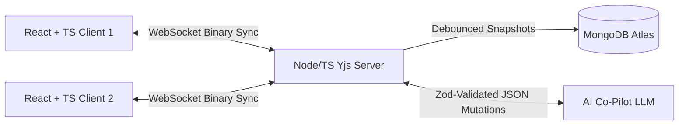

# Realtime Collab Board 🚀

An AI-native, real-time multiplayer Kanban workspace built with **React, TypeScript, Yjs (CRDTs), WebSockets, and MongoDB**. 

Instead of a passive sidebar chatbot, the embedded **AI Co-Pilot** acts as a real-time multiplayer board operator—translating natural language commands into deterministic, Zod-validated CRDT state mutations while respecting active human edits.

---

## 🤖 How the AI Co-Pilot Works

When a user enters a plain-English command (e.g., *"Move all finished tasks to Done and split the Auth task into 3 steps"*), the co-pilot executes through four engineering layers:

1. **Live Context Injection:** Before calling the LLM, the server captures the real-time board snapshot (column IDs, card IDs, priorities), online teammates, and active user locks from the shared Yjs document.
2. **Structured Zod Schemas:** Instead of returning unstructured chat text, **Zod** discriminated unions enforce a strict JSON contract (`ADD_CARD`, `MOVE_CARD`, `UPDATE_CARD`, `DELETE_CARD`). The Node.js server applies these operations directly to the shared `Y.Doc`, updating every connected client simultaneously.
3. **Multiplayer Concurrency Locks:** Using Yjs Awareness, the client tracks which cards humans are actively dragging or editing (`lockedCardIds`). These IDs are injected into the prompt with a strict guardrail preventing the AI from overwriting or deleting in-use cards.
4. **Prompt Caching Architecture:** Static system rules and few-shot examples sit at the top of the prompt while dynamic board JSON sits at the bottom—maximizing provider prefix caching to cut latency and token costs on repeated commands.

---

## ✨ Key System Highlights

* **Conflict-Free Real-Time Sync (CRDTs):** Powered by **Yjs** over WebSockets for sub-50ms state synchronization, offline resilience, and live multiplayer cursor awareness.
* **Debounced MongoDB Persistence:** Automatically serializes binary Yjs snapshots (`Y.encodeStateAsUpdate`) into MongoDB Atlas without blocking real-time WebSocket throughput.

---

## 🏗️ System Architecture



---

## 🛠️ Tech Stack

* **Frontend:** React, TypeScript, Vite, Tailwind CSS, Yjs
* **Backend:** Node.js, Express, TypeScript, `ws` (WebSockets), Yjs
* **Database:** MongoDB Atlas (Mongoose)
* **AI & Prompt Layer:** Vercel AI SDK, OpenAI / Gemini, Zod

---

## 🚀 Local Setup

1. **Clone the repository**
   ```bash
   git clone https://github.com
   cd Realtime-collab-board
   ```

2. **Configure environment variables**
   ```bash
   cp .env.example server/.env

   ```

3. **Run the Backend Server**
   ```bash
   cd server
   npm install
   npm run dev
   ```

4. **Run the React Frontend**
   ```bash
   cd client
   npm install
   npm run dev
   ```
