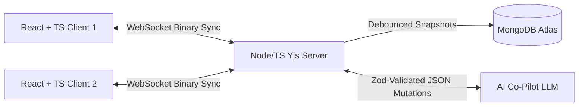

# Realtime Collab Board 🚀

An AI-native, real-time multiplayer Kanban workspace built with **React, TypeScript, Yjs (CRDTs), WebSockets, and MongoDB**. 

Instead of a passive sidebar chatbot, the embedded **AI Co-Pilot** acts as a real-time collaborator—translating natural language commands into deterministic, Zod-validated CRDT state mutations while respecting active user locks.

---

## ✨ Key Engineering Highlights

* **Conflict-Free Real-Time Sync (CRDTs):** Powered by **Yjs** over WebSockets for sub-50ms state synchronization, offline resilience, and live multiplayer cursor awareness.
* **AI Co-Pilot with Structured Outputs:** Uses the Vercel AI SDK + **Zod Discriminated Unions** to guarantee 100% schema-valid JSON operations (`ADD_CARD`, `MOVE_CARD`, `UPDATE_CARD`, `DELETE_CARD`) applied directly to the shared `Y.Doc`.
* **Multiplayer Concurrency Guards:** Injects live cursor/drag state (`lockedCardIds`) into the LLM context so the AI never overwrites cards actively being edited by human teammates.
* **Prompt Caching Architecture:** Orders static system instructions and few-shot examples ahead of dynamic board snapshots to maximize provider prefix caching and minimize Time-To-First-Token (TTFT).
* **Debounced MongoDB Persistence:** Automatically serializes binary Yjs snapshots (`Y.encodeStateAsUpdate`) into MongoDB Atlas without blocking real-time WebSocket throughput.

---

## 🏗️ System Architecture



---

## 🛠️ Tech Stack

* **Frontend:** React, TypeScript, Vite, Tailwind CSS, Yjs
* **Backend:** Node.js, Express, TypeScript, `ws` (WebSockets), Yjs
* **Database:** MongoDB Atlas (Mongoose)
* **AI & Prompt Layer:** Vercel AI SDK, OpenAI / Gemini, Zod

---

## 🚀 Local Setup

1. **Clone the repository**
   ```bash
   git clone https://github.com
   cd Realtime-collab-board
   ```

2. **Configure environment variables**
   ```bash
   cp .env.example server/.env
   # Add your MONGODB_URI and OPENAI_API_KEY inside server/.env
   ```

3. **Run the Backend Server**
   ```bash
   cd server
   npm install
   npm run dev
   ```

4. **Run the React Frontend**
   ```bash
   cd client
   npm install
   npm run dev
   ```
